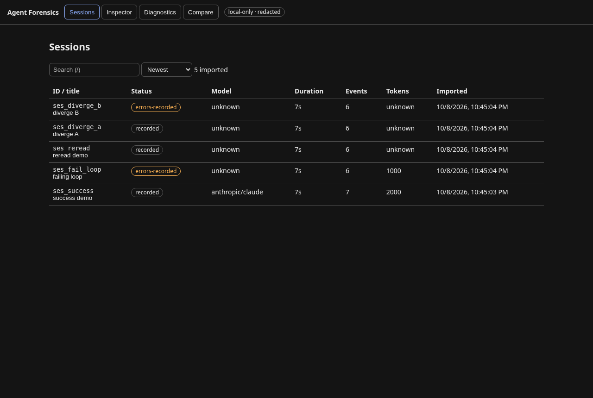

# Agent Forensics

Local-first, deterministic debugging and differential analysis for AI coding-agent sessions — OpenCode-first.

It answers: **"The agent failed, looped, or burned tokens. Where, with what evidence, and how does this run differ from another?"** No model key, account, cloud, or collector required.

## Why not another viewer?
- Session viewers show transcripts; they don't diagnose loops or compare runs.
- OTel stacks need live instrumentation and short retention; they aren't reproducible forensics.
- Telemetry plugins aggregate metrics; they don't do paired baseline-vs-candidate diffs with evidence links.
- Agent Forensics imports sanitized OpenCode exports, normalizes to evidence events, runs transparent rules, and aligns two runs to a first divergence. See `docs/RESEARCH.md`.

## Quickstart
```bash
npm ci && npm run build
# import a real session (read-only, sanitized at source)
opencode session export ses_XXXX --sanitize > /tmp/ses.json
node dist/cli.js import /tmp/ses.json
node dist/cli.js inspect ses_XXXX
node dist/cli.js analyze ses_XXXX
# compare two runs
node dist/cli.js compare ses_AAAA ses_BBBB
node dist/cli.js export ses_AAAA --out ./report.json
node dist/cli.js ui  # http://127.0.0.1:4311
```



## Testing
```bash
npm run typecheck
npm test -- --run
npm run build
npm run test:e2e
```

## CLI
` sessions | import <file|ses_ID> | inspect <id> | analyze <id> | compare <a> <b> | export <id> --out <f> [--force] | ui [--port]`
Append `--json` for scripting. Exit codes: 0 ok, 1 usage/refusal, 2 not-found, 3 corrupt.

## Rules (deterministic, tested)
- `repeated-tools` — same tool+args ≥3× (info/warning).
- `failure-loop` — same failure signature ≥3×, no progress (critical).
- `file-reread` — same file read ≥3×, no intervening edit (warning).
- `latency-hotspot` / `cost-hotspot` — measured durations/tokens only; per-tool tokens never invented.
- `suspicious-pattern` — edit→same-test-fail, tight action cycles (low/medium, heuristic).

Every finding carries `evidenceEventIds` — open them in Inspector or `inspect --json`.

## Privacy
Redacted-only store (`data/sessions/*.json`, 0600), redaction before write, metadata-only logs, no exec of imported content, text-only rendering, CSP, no outbound calls. Redaction is best-effort — review before sharing.

## Limits
Supports OpenCode V2 exports (`2.0.x`, verified `2.0.25/26`). Token/cost fields may be missing (reported unknown). Direct DB reads unsupported. JSON file store (SQLite path reserved).

## Example
```bash
$ node dist/cli.js analyze ses_fail_loop
[critical] failure-loop: Failure loop: bash failed 4× with the same signature
  evidence: t1, t2, t3, t4
  Observed: same failure signature, similar args, no meaningful progress. ...

$ node dist/cli.js compare ses_diverge_a ses_diverge_b
A=ses_diverge_a (6)  B=ses_diverge_b (6)
matches=5 uniqueA=1 uniqueB=1
first divergence: A#5 (t4) vs B#? (-)
tokens: A=unknown B=unknown delta=unknown
errors: A=0 B=1
```
